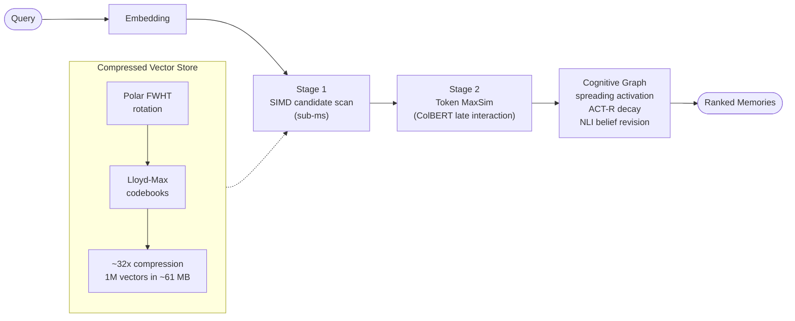
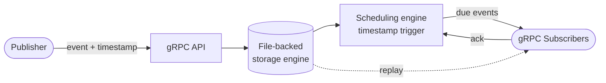
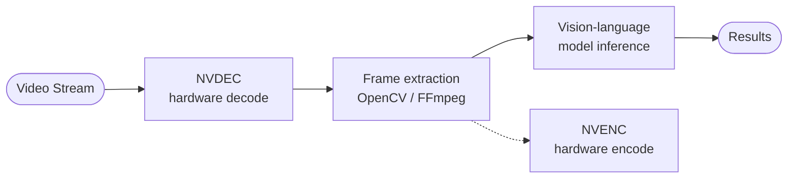
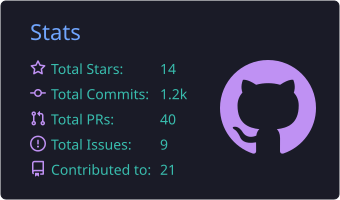
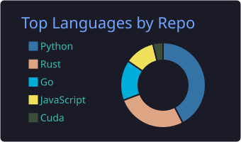
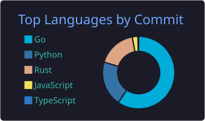
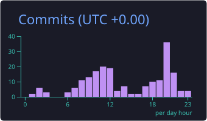

<!-- ===================================================== -->
<!--                JATIN MAHAJAN · PROFILE README          -->
<!-- ===================================================== -->

  

  

  <b>Building high-performance storage engines, distributed event systems, and GPU-accelerated ML infrastructure from first principles.</b>

  
  
  

  
  
  

  <a href="#featured"><b>Featured Systems</b></a> &nbsp;•&nbsp;
  <a href="#repos"><b>Repositories</b></a> &nbsp;•&nbsp;
  <a href="#architecture"><b>Architecture</b></a> &nbsp;•&nbsp;
  <a href="#stack"><b>Toolchain</b></a> &nbsp;•&nbsp;
  <a href="#stats"><b>GitHub Stats</b></a> &nbsp;•&nbsp;
  <a href="#connect"><b>Connect</b></a>

---

## ⚡ Featured Systems & Engineering

<table>
  <tr>
    <td width="50%" valign="top">
      <h3>🦀 <a href="https://github.com/jatin711-debug/TurboSupermemory">TurboSuperMemory</a></h3>
      
<b>High-performance cognitive memory &amp; vector storage engine written in Rust &amp; CUDA.</b>

      <ul>
        <li><b>32× TurboQuant Compression</b>: 1M vectors in ~61 MB using Polar Fast Walsh-Hadamard Transforms (FWHT) + Lloyd-Max codebooks.</li>
        <li><b>2-Stage Hybrid Retrieval</b>: Sub-ms SIMD candidate scan + Stage-2 token MaxSim late interaction (ColBERT).</li>
        <li><b>Cognitive Graph</b>: In-memory spreading activation, ACT-R power-law decay, and NLI-based belief revision with &#36;0.00 write-time LLM cost.</li>
      </ul>
      

        
        
        
        
        
        
      

    </td>
    <td width="50%" valign="top">
      <h3>🗄️ <a href="https://github.com/jatin711-debug/CronosDB">CronosDB</a></h3>
      
<b>Timestamp-triggered pub/sub database engineered for precise time-scheduled event delivery.</b>

      <ul>
        <li>At-least-once delivery semantics with persistent event replay.</li>
        <li>Custom file-backed storage engine with low operational overhead.</li>
        <li>High-throughput gRPC subscriber pipeline &amp; scheduling engine.</li>
      </ul>
      

        
        
        
        
        
      

    </td>
  </tr>
  <tr>
    <td width="50%" valign="top">
      <h3>🩺 Medical Multimodal AI</h3>
      
<b>Vision-language fine-tuning &amp; explainable medical imaging pipelines.</b>

      <ul>
        <li>Fine-tuned <b>Med-GEMMA</b> models for pneumothorax and clinical diagnosis.</li>
        <li>Attention heatmap extraction and GPU memory footprint optimization.</li>
      </ul>
      

        
        
        
        
      

    </td>
    <td width="50%" valign="top">
      <h3>🎥 GPU Video AI Pipelines</h3>
      
<b>Low-latency hardware-accelerated media preprocessing and inference.</b>

      <ul>
        <li>Hardware-accelerated decoding/encoding via NVIDIA NVENC/NVDEC.</li>
        <li>High-throughput frame extraction for vision-language models.</li>
      </ul>
      

        
        
        
        
        
      

    </td>
  </tr>
</table>

---

## 📌 Repository Pulse

<table>
  <tr>
    <td width="50%" align="center">
      <b><a href="https://github.com/jatin711-debug/TurboSupermemory">TurboSupermemory</a></b>  
      
      
      
      
    </td>
    <td width="50%" align="center">
      <b><a href="https://github.com/jatin711-debug/CronosDB">CronosDB</a></b>  
      
      
      
      
    </td>
  </tr>
</table>

---

## 🧠 Architecture at a Glance

> Click to expand the system diagrams.

<b>🦀 TurboSuperMemory: retrieval &amp; cognition pipeline</b>

 

<b>🗄️ CronosDB: time-scheduled event delivery</b>

 

At-least-once delivery: events are persisted before dispatch and replayed until acknowledged.

<b>🎥 GPU video pipeline: decode → extract → infer</b>

 

---

## 🧰 Core Toolchain & Technologies

  

| Domain | Technologies |
| :--- | :--- |
| **⚙️ Systems & Storage** | `Rust` `Go` `C++` `CUDA` `SIMD/AVX2` `PostgreSQL` `Kafka` `Redis` `SQLite` `redb` |
| **🤖 ML & Inference** | `PyTorch` `vLLM` `Triton Inference Server` `SGLang` `SentenceTransformers` `HuggingFace` |
| **🏗️ Infra & Media** | `Docker` `Kubernetes` `Linux` `gRPC` `Axum` `FFmpeg` `NVIDIA NVDEC` |

---

## 📊 GitHub Stats

  
  

  
  

  

Cards are generated daily by a GitHub Action, so they never depend on a third-party server being online.

---

## 🤝 Let's Connect

Always up for conversations about storage engines, distributed systems, GPU pipelines, and ML infrastructure.

  
  
  

  

